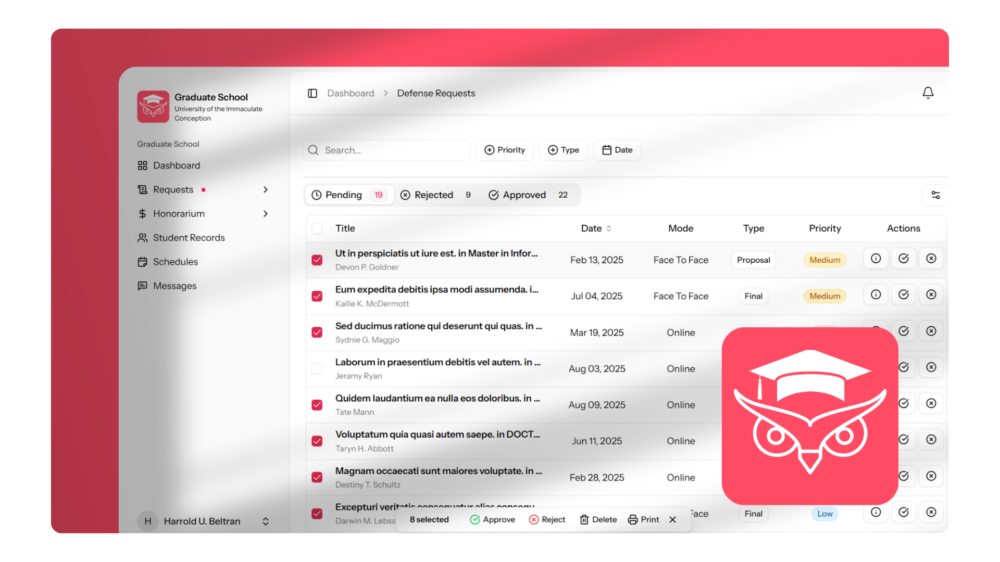

<p align="center">
  
</p>


<h1 align="center">Graduate School System</h1>

  
</p>


---

## Description

The **Graduate School System** is a web application designed to modernize and streamline administrative workflows for UIC’s Graduate School. The application supports core administrative processes for students, coordinators, administrative staff, deans, and the registrar.

This repository is the combined work of three collaborating groups:
- **Defense Requests**
- **Honorariums**
- **Comprehensive Exams**

---

## Objectives

- Provide clear, role-based workflows for defense and comprehensive exam processes.
- Maintain accurate tracking of honorariums and related financial records.
- Improve transparency of statuses, schedules, and required documents.
- Support reporting and printable exports for academic and finance use.
- Deliver real-time notifications and updates for relevant stakeholders.

---

## Scope & Features

### System-wide
- Role-based access control and permissions
- Role-specific dashboards (pending items, upcoming schedules, counters)
- In-app notifications and real-time updates
- Audit logs for approvals, edits, and payment events
- Printable/exportable reports (PDF/CSV)

### Defense Requests
- Student submission and file uploads for defense requests
- Coordinator review, schedule editing, and panelist management
- Administrative Assistant approval and defense status management
- Dean/AA reporting and oversight for defense-related finances

### Honorariums
- CRUD for honorarium entries (panelists, amounts, statuses)
- Tracking of student-financial records tied to defense/exam activities
- Generation and printing of summary reports
- Receipt attachment and payment status tracking

### Comprehensive Exams
- Student application submission and document uploads
- Payment receipt uploads and application tracking
- Scheduling and examiner assignment (Coordinator / Dean / AA)
- Registrar document verification and official-status updates

---

## Roles (Summary)

- **Student:** Submit forms, upload documents/receipts, view status & schedules
- **Coordinator:** Review and track submissions, manage schedules, validate records
- **Administrative Assistant (AA):** Approve/deny requests, manage honorarium records, produce reports
- **Dean:** Oversight, reporting, final approvals
- **Registrar:** Verify documents, update official student record statuses

---

## Typical Workflows (High-Level)

- Student submits requests/applications and uploads supporting documents
- Coordinators and AAs process submissions, manage schedules, and update statuses
- Honorarium records are created and tracked as required
- Registrar verifies documents and updates official records
- Dashboards, notifications, and reports communicate status and outcomes to stakeholders

---

## Data & Reporting

- **Entities:** Students, defense requests, exam applications, panelists, honorarium records, schedules, receipts, documents
- **Reporting:** Period summaries, per-panelist payment history, per-student financial obligations, pending approvals, audit logs
- **Export formats:** CSV and printable PDF

---

## Local Development Setup

This section documents the setup required to run the project locally, including the migration from XAMPP/SQLite to **Laravel Herd + MySQL** and the configuration of **Google SSO**.

### Prerequisites

Install the following on your Windows machine:

1. **Laravel Herd** — https://herd.laravel.com/windows (replaces XAMPP's Apache with Nginx; bundles PHP 8.2+)
2. **MySQL Server 8.0** — https://dev.mysql.com/downloads/installer/ (use MySQL Installer, NOT DBngin)
   - Set `root` password to: **`root`**
   - Default port: `3306`
3. **MySQL Workbench 8.0** (optional, for DB GUI) — install via the same MySQL Installer
4. **Composer** — https://getcomposer.org/Composer-Setup.exe
5. **Node.js (LTS)** — https://nodejs.org/

### Project Location

Place the project in Herd's default directory:

```
C:\Users\<your-username>\Herd\graduate-school-system
```

### Installation Steps

```powershell
cd C:\Users\<your-username>\Herd\graduate-school-system
composer install
npm install
php artisan key:generate
```

### Database Setup

Create the database using MySQL CLI (or Workbench):

```powershell
"C:\Program Files\MySQL\MySQL Server 8.0\bin\mysql.exe" -u root -p
```

```sql
CREATE DATABASE grad_db;
EXIT;
```

Then run migrations:

```powershell
php artisan migrate:fresh --force
```

### Environment Configuration (`.env`)

Use these **critical** settings:

```env
APP_URL=http://localhost:8000

DB_CONNECTION=mysql
DB_HOST=127.0.0.1
DB_PORT=3306
DB_DATABASE=grad_db
DB_USERNAME=root
DB_PASSWORD=root

GOOGLE_CLIENT_ID=your-client-id.apps.googleusercontent.com
GOOGLE_CLIENT_SECRET=your-client-secret
GOOGLE_REDIRECT_URI=http://localhost:8000/auth/google/callback
```

> ⚠️ **`APP_URL` must be `http://localhost:8000`** — Google OAuth rejects `.test` domains.

### Google OAuth Setup

1. Go to https://console.cloud.google.com/ and create a project
2. **APIs & Services** → **Credentials** → **Create OAuth 2.0 Client ID** (Web application)
3. Add this **Authorized redirect URI**:
   ```
   http://localhost:8000/auth/google/callback
   ```
4. Copy the Client ID and Client Secret into `.env`

### Running the App

```powershell
php artisan serve
```

Visit: **http://localhost:8000**

In a separate terminal for frontend assets:

```powershell
npm run dev
```

---

## Recent Setup Changes (Migration Notes)

The following changes were made to get Google SSO working with Laravel Herd + MySQL:

### 1. Migrated from XAMPP to Laravel Herd
- Moved project from `C:\xampp\htdocs\SOFTWARE_ENGEERING_2\-Graduate_School_System` to `C:\Users\matth\Herd\graduate-school-system`
- Used `robocopy /E /XD node_modules vendor .git` to copy without heavy folders
- Herd auto-detects projects in `~\Herd\` and serves them at `http://<project>.test`

### 2. Migrated from SQLite to MySQL
- Installed MySQL Server 8.0 via MySQL Installer (DBngin was tested and caused issues)
- Created `grad_db` database
- Updated `.env`: `DB_CONNECTION=mysql`, host `127.0.0.1`, user `root`, password `root`
- Deleted old `database/database.sqlite` file
- Ran `php artisan migrate:fresh --force` — all 80+ migrations succeeded

### 3. Fixed Google OAuth Redirect URI
- **Problem**: Google rejected `http://graduate-school-system.test/auth/google/callback` (`.test` domains are not allowed)
- **Solution**: Reverted `APP_URL` to `http://localhost:8000` and updated Google Cloud Console redirect URI to match
- Run the server with `php artisan serve` (not Herd's auto `.test` domain) so OAuth works

### 4. Fixed GoogleAuthController
File: `app/Http/Controllers/Auth/GoogleAuthController.php`

Two fixes were applied:

- **Force account selection** (so users can switch Google accounts):
  ```php
  ->with(['prompt' => 'select_account'])
  ```

- **Fix NOT NULL constraint on user creation** (auto-generated password for OAuth-only users):
  ```php
  'password' => bcrypt(uniqid())
  ```

---

## Troubleshooting

| Issue | Fix |
|---|---|
| Google OAuth `redirect_uri_mismatch` | Ensure Google Cloud Console redirect URI is exactly `http://localhost:8000/auth/google/callback` (no `.test`) |
| MySQL `Access denied for user 'root'` | Verify password is `root` in `.env`; check MySQL service is running |
| `SQLSTATE[HY000] [2002]` | Start MySQL: `net start MySQL80` (as Administrator) |
| Port 8000 in use | `netstat -ano \| findstr :8000` then `taskkill /PID <PID> /F` |
| Migration errors | `php artisan migrate:fresh --force`; verify `grad_db` exists |
| `Class 'Google_Client' not found` | `composer require laravel/socialite` |
| Google not prompting account selection | Use incognito mode or clear cookies; the `prompt=select_account` fix is already in `GoogleAuthController.php` |

---

## Developer Onboarding Checklist

- [ ] Install Laravel Herd
- [ ] Install MySQL Server 8.0 (root password: `root`)
- [ ] Install Composer and Node.js
- [ ] Copy project to `C:\Users\<you>\Herd\graduate-school-system`
- [ ] Run `composer install` and `npm install`
- [ ] Run `php artisan key:generate`
- [ ] Create `grad_db` database in MySQL
- [ ] Run `php artisan migrate:fresh --force`
- [ ] Configure `.env` (use `localhost:8000`, MySQL credentials)
- [ ] Set up Google OAuth credentials with redirect URI `http://localhost:8000/auth/google/callback`
- [ ] Start server: `php artisan serve`
- [ ] Visit `http://localhost:8000` and test Google login

---

## Architecture & Tech Stack

**Backend:**  
Laravel 12, PHP, Composer

**Frontend:**  
ReactJS with TypeScript, ShadCN UI, Tailwind CSS

**Real-time / Notifications:**  
Laravel Echo (compatible with Pusher or other WebSocket backends)

**Database & Hosting / Services:**  
Designed for local development (XAMPP) and managed environments (Laravel Cloud, Supabase)

**CI / CD:**  
GitHub Actions

**Other:**  
Node (npm/yarn) for frontend dependency management

---

## Contributors

### Defense Requests
- Weszley Keith Empasis
- Geoffrey Diapana
- John Paul Estano

### Honorarium
- Quezada Jim Nick
- Bianca Noreen Otara
- Troy Peralta

### Comprehensive Exam
- Nash Golosino
- King Philipp Fernandez
- Paul Honrada
